# Living-Room Lamp Scenes

## Scene Schedule Diagram

Each scene below is a card showing what the three lamps are doing. Follow the arrows through one day of the smart-home routine.

```mermaid
%%{init: {'theme': 'base', 'themeVariables': {'fontSize': '13px', 'fontFamily': 'system-ui'}} }%%
flowchart LR
    classDef on fill:#dcfce7,stroke:#16a34a,stroke-width:2px,color:#14532d,font-weight:bold
    classDef off fill:#f1f5f9,stroke:#cbd5e1,stroke-width:1px,color:#94a3b8

    subgraph S0["Night"]
        direction TB
        N1["Desk lamp<br/><i>off</i>"]:::off
        N2["Floor lamp<br/><i>off</i>"]:::off
        N3["String lights<br/><i>off</i>"]:::off
    end

    subgraph S1["Scene 1 — Wake-up"]
        direction TB
        W1["Desk lamp<br/><i>off</i>"]:::off
        W2["Floor lamp<br/><b>WARM DIM 30%</b>"]:::on
        W3["String lights<br/><i>off</i>"]:::off
    end

    subgraph S2["Scene 2 — Work From Home Hours"]
        direction TB
        K1["Desk lamp<br/><b>COOL WHITE 80%</b>"]:::on
        K2["Floor lamp<br/><i>off</i>"]:::off
        K3["String lights<br/><i>off</i>"]:::off
    end

    subgraph S3["Scene 3 — Evening"]
        direction TB
        E1["Desk lamp<br/><i>off</i>"]:::off
        E2["Floor lamp<br/><b>WARM DIM 30%</b>"]:::on
        E3["String lights<br/><b>TWINKLE SLOW</b>"]:::on
    end

    S0 -->|"Alarm at 07:00<br/>Floor lamp fades in"| S1
    S1 -->|"Laptop wakes up<br/>(calendar says work)"| S2
    S2 -->|"Last meeting ends<br/>Desk lamp off"| S3
    S3 -.->|"Bedtime 23:00<br/>Everything off · repeat"| S0
```

Trailing prose.
