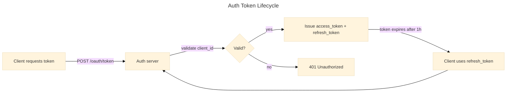

# Auth Token Lifecycle

The author has already injected `flowchart-padding-init` to give edge labels breathing room. The reviewer's job is to keep that padding intact when the zinc-light theme is added — historically the themed render would silently drop the padding because two competing `%%{init: …}%%` blocks were emitted.

