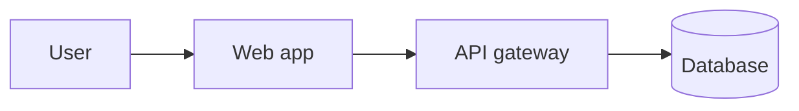
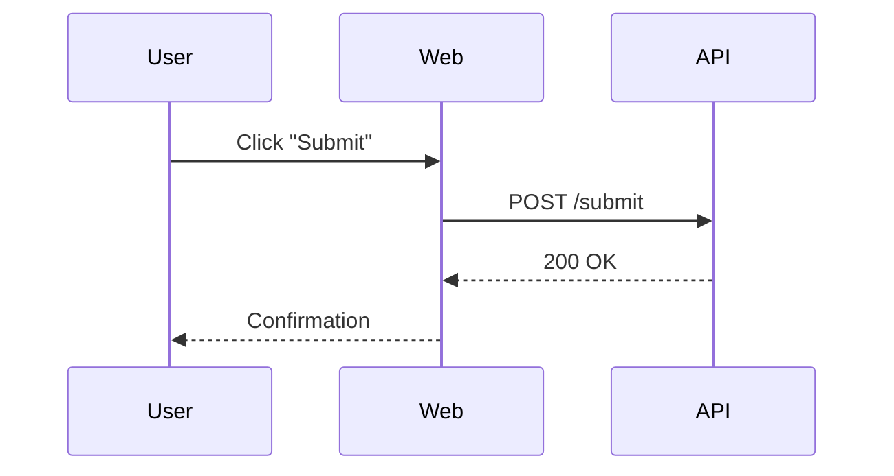

# System Architecture Notes

Two diagrams in this file. The skill should prompt for which one to review rather than guess.

## High-level flow

Some prose between the two blocks.

## Sequence detail

Trailing prose.
