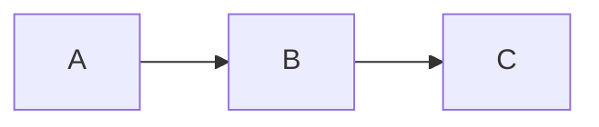

# Diagram with a broken init block

The init block has a trailing comma and a missing closing brace — mermaid will fail to parse. The skill should detect this at the Step 2 sanity render and report cleanly rather than entering the iteration loop.

